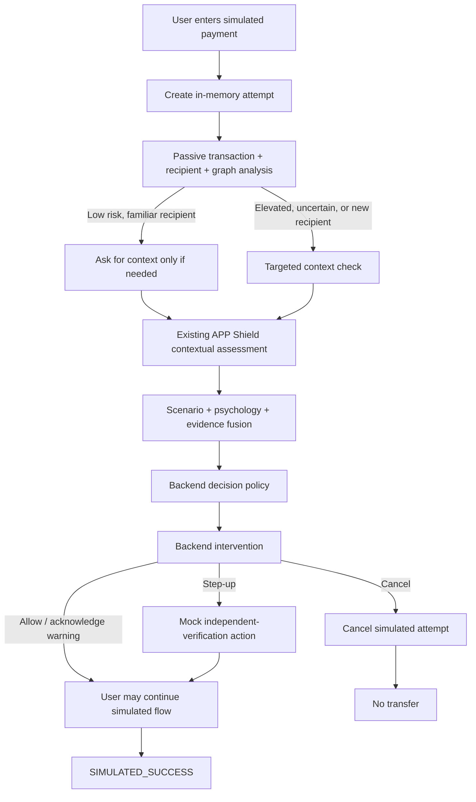

# APP Shield Day 8 — Payment Simulation

Day 8 adds a local APP Shield Pay payment flow. A payment attempt remains simulated from creation through cancellation or simulated completion; no payment provider is configured, and no money moves. Every decision and intervention is returned by the existing backend assessment and intervention services.

## Architecture



React/Vite renders backend responses; it does not calculate risk thresholds or decisions. The passive pass calls the existing `RiskService.score` and graph scorer. Contextual analysis uses `RiskService.score_contextual` and `FraudEngine.analyze_payment`, passing the already computed result through a backward-compatible optional argument. State transitions are validated by an explicit backend state machine.

## Run locally

From the project root, open two PowerShell terminals.

Backend:

```powershell
.\.venv\Scripts\python.exe -m uvicorn backend.app.main:app --host 127.0.0.1 --port 8000
```

Frontend:

```powershell
Set-Location frontend
npm run dev
```

Open `http://127.0.0.1:5173` for the payment flow, `/demo` for the scenario library, `/analyst` for the analyst dashboard, or `http://127.0.0.1:8000/docs` for API documentation. Vite proxies `/api` requests to the local FastAPI server. The seeded demo accounts and scenario list are synthetic.

For the flagship demonstration, select **Government impersonation — flagship**, review the ₹3,500 request, continue to safety analysis, and inspect the targeted intervention. Use **Analyst view** to see the passive transaction baseline beside contextual risk, confidence, model evidence, missing evidence, and the bounded recipient neighborhood. The account profile uses a known device and the transaction-only model scored 13.69/100; the complete contextual assessment scored 34.58/100 and returned a government-impersonation intervention. In this actual model run, the backend policy decision was `ALLOW_WITH_WARNING` (intervention level 3), so the demo requires explicit acknowledgement before its simulated continue action. These values are evidence indices, not fraud probabilities.

The app includes 13 prefilled cases: normal friend, legitimate large purchase, merchant, government impersonation, bank impersonation, investment pressure, fake job fee, tech support, family emergency, small investment, recipient network review, Hinglish bank impersonation, and missing context.

## API

All routes are under `/api/v1/simulated-payments`:

| Method | Path | Purpose |
| --- | --- | --- |
| GET | `/accounts` | Safe synthetic account aliases |
| GET | `/scenarios` and `/scenarios/{id}` | Scenario catalog and prefill data |
| POST | `/` | Create an idempotent simulated attempt |
| POST | `/{id}/analyze` | Passive check and, when supplied, full contextual assessment |
| POST | `/{id}/continue` | Record simulated continue after policy requirements |
| POST | `/{id}/verify` | Mock independent verification or cancel |
| POST | `/{id}/cancel` | Cancel without transfer |
| GET | `/{id}` | User-safe status; no risk scores |
| GET | `/{id}/analyst` | Analyst-only assessment fields |
| GET | `/{id}/network` | Bounded two-hop analyst graph |
| GET | `/analytics` | In-memory simulation counts |

Attempts are held in a bounded in-memory store and reset when the backend restarts. A repeated idempotency key returns the original attempt only when the request body matches; mismatched reuse returns HTTP 409. The attempt store evicts a finished record when full and refuses creation if every slot is actively analyzing.

## Actual scenario validation

The following output was generated by running every bundled scenario through the in-process FastAPI application and its loaded synthetic models. The checks are broad scenario-specific behavior checks; passing them is not an accuracy or calibration claim. Transaction-only and full risk are 0–100 evidence scores. Confidence is a separate [0,1] field. Latency is the measured simulator analysis time in milliseconds.

| Scenario | Transaction-only | Full APP Shield | Confidence | Detected scenario | Backend decision | Analysis time | Check |
| --- | ---: | ---: | ---: | --- | --- | ---: | --- |
| Normal friend payment | 0.05 | 0.00 | 0.5900 | normal_or_unknown | ALLOW_WITH_WARNING | 94.68 ms | PASS |
| Legitimate large purchase | 30.07 | 9.20 | 0.5368 | normal_or_unknown | ALLOW_WITH_WARNING | 43.08 ms | PASS |
| Established merchant | 14.33 | 0.00 | 0.5897 | normal_or_unknown | ALLOW | 34.42 ms | PASS |
| Government impersonation — flagship | 13.69 | 34.58 | 0.5167 | government_impersonation | ALLOW_WITH_WARNING | 53.82 ms | PASS |
| Bank impersonation | 47.48 | 62.27 | 0.6255 | bank_impersonation | WARN_AND_REVIEW | 51.68 ms | PASS |
| Investment pressure | 0.06 | 17.76 | 0.5381 | investment_scam | ALLOW | 53.27 ms | PASS |
| Fake job fee | 16.98 | 43.80 | 0.5815 | fake_job_scam | WARN_AND_REVIEW | 56.04 ms | PASS |
| Tech support pressure | 44.00 | 46.88 | 0.6209 | tech_support_scam | WARN_AND_REVIEW | 65.71 ms | PASS |
| Family emergency request | 46.45 | 39.53 | 0.6406 | family_emergency_scam | ALLOW_WITH_WARNING | 58.22 ms | PASS |
| Small initial investment scam | 16.50 | 35.33 | 0.5125 | investment_scam | ALLOW_WITH_WARNING | 88.64 ms | PASS |
| Recipient network review | 44.85 | 16.37 | 0.5309 | normal_or_unknown | ALLOW | 34.32 ms | PASS |
| Hinglish bank impersonation | 43.49 | 63.50 | 0.6186 | bank_impersonation | WARN_AND_REVIEW | 44.39 ms | PASS |
| New recipient, context not provided | 13.69 | — | — | not scored | CONTEXT_REQUIRED | — ms | PASS |

Report: [`evaluation/day8_scenario_validation.json`](evaluation/day8_scenario_validation.json). Generated at 2026-10-03T13:06:59.633513+00:00; 13/13 broad behavior checks passed. In particular, the flagship has low transaction-only evidence, contextual uplift, detected government impersonation, authority and secrecy labels, and a targeted government warning. It does not force an unearned `STEP_UP_VERIFICATION` outcome.

## Privacy and operating limits

- Demo profiles, amounts, recipients, text, graph and outputs use the local synthetic corpus.
- No real PayPal, Paytm, UPI, bank, card or payment-gateway integration exists.
- The interface warns against entering OTPs, PINs, CVVs, passwords or card credentials; strict request models reject extra fields and message checks reject common credential-value patterns.
- The user endpoint omits numeric risk and internal evidence. Scores, features, explanation codes and graph details are exposed only by the analyst demo endpoints, which are not authenticated and must not be exposed outside a trusted local demo environment.
- The attempt store is process-local and resets at restart. It does not provide persistence, multi-worker coordination, production availability, or a production authorization boundary.
- Results are based on synthetic models and scenario cases; they are not validated estimates of real-world fraud probability or effectiveness.
- Verification is a mock acknowledgement only. A completed attempt is labeled `SIMULATED_SUCCESS`; it represents no actual transfer.
