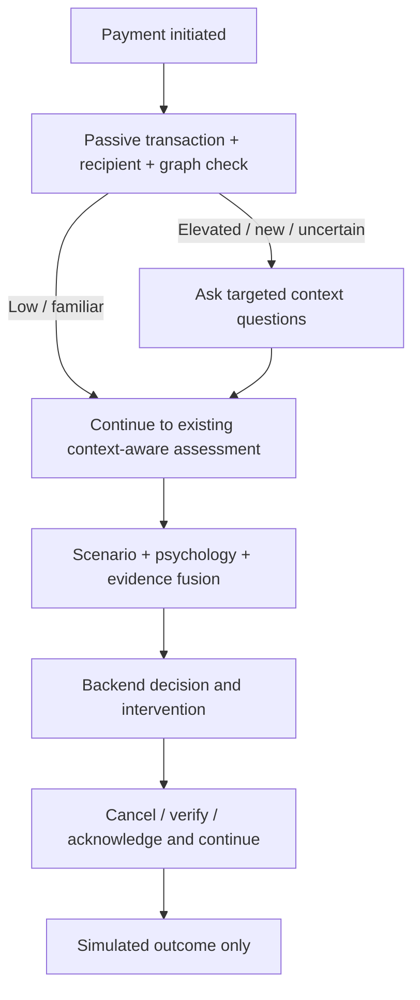

# APP Shield — Context-Aware Authorized Payment Scam Detection

APP Shield is a research-oriented pre-payment scam detection system designed to identify authorized social-engineering fraud by combining transaction, recipient-network, payment-context, scam-scenario, and psychological-manipulation signals before a simulated payment is completed. It is a local synthetic-data prototype; it does not connect to or represent PayPal, Paytm, banks, or UPI providers.

The customer entry point is one chat with three actions: make a payment, check a simulated balance, and view transaction details. The React/FastAPI app also includes APP Shield's fraud checks and separate analyst/research routes. Start with the [quick guide](docs/QUICK_START.md), [simulated banking notes](docs/BANKING_DEMO.md), [architecture](docs/ARCHITECTURE.md), or [final measured results](reports/FINAL_RESULTS.md).

## Quick start

For Windows, install Python 3.11+ and Node.js 20.19+ or 22.12+, then run this from the project folder:

```powershell
.\start.bat
```

The launcher checks dependencies, safely initializes wholly missing demo assets, starts the local API and frontend, checks readiness, and opens `http://127.0.0.1:5173/`. Stop APP Shield's own processes with `stop.bat`. See [Quick Start](docs/QUICK_START.md) for manual setup on other platforms.

APP Shield is a synthetic demo. It does not connect to a bank or transfer real money. Wallet balances and completed simulated transfers use SQLite by default; hosted deployments can set `APP_SHIELD_MONGO_URI` and `APP_SHIELD_MONGO_DATABASE=appshield` to use MongoDB for wallets and ledger records. Analyst feedback/audit history remains in its configured SQLite database. Initial demo balances are seeded once from `APP_SHIELD_DEMO_BALANCE_U101` (₹10,000), `APP_SHIELD_DEMO_BALANCE_U102` (₹2,000), and `APP_SHIELD_DEMO_BALANCE_U103` (₹10,000). Set these in the process environment before first startup to change initial demo values. The browser's profile picker issues a local demo bearer session; it is account-scoped for this simulation, not real identity authentication. Do not expose the demo API as a banking service. `python -m scripts.seed_demo` validates bundled fraud data/models without overwriting them. `python -m scripts.reset_demo --yes` removes only local feedback/audit/review history; restart the backend to clear in-memory chat/payment attempts.

User workflows: [User Guide](docs/USER_GUIDE.md) · [Conversational Agent](docs/CONVERSATIONAL_AGENT.md) · [Analyst Guide](docs/ANALYST_GUIDE.md) · [Research Guide](docs/RESEARCH_GUIDE.md) · [Troubleshooting](docs/TROUBLESHOOTING.md) · [API guide](docs/API.md)

## Public demo hosting

Deployment configuration is provided for a Vercel static frontend and a Render FastAPI service. Follow [Public Demo Deployment](docs/DEPLOYMENT.md) to set the frontend API URL, exact CORS origin, and persistent backend storage. The Render backend uses a paid single-instance service with a persistent disk so synthetic balances survive restarts; chat state remains in memory and resets when the backend restarts. This setup is a public research demo, not production banking.

Reproduce reports with `python -m scripts.reproduce_results`. The source data has already been examined during development; its frozen copy is for reproducibility, not a pristine unseen test set.

## Project history

Days 1–8 built the synthetic data, intelligence components, evidence fusion, interventions, and simulator. Day 9 added feedback, audit, monitoring, temporal evaluation and deployment packaging. Day 10 consolidates reproducibility and research documentation.

## Run locally (Python 3.11+)

Run these commands from the app-shield directory:

~~~powershell
python -m venv .venv
.venv\Scripts\python -m pip install -r backend/requirements.txt
.venv\Scripts\python -m scripts.generate_transactions
.venv\Scripts\python -m scripts.analyze_transactions --output data/processed/analysis.txt
.venv\Scripts\python -m ml.transaction.train
.venv\Scripts\python -m ml.recipient.train
.venv\Scripts\python -m pytest -q
.venv\Scripts\python -m uvicorn backend.app.main:app --host 127.0.0.1 --port 8000
~~~

GET / returns project=APP Shield and status=running. GET /health returns status=healthy.
Open http://127.0.0.1:8000/docs for endpoint documentation.

## Data

The default seed 42 creates 1,000 normal users, 40 suspicious accounts and 10,000 payments (7.5% fraud), covering seven APP scenarios. Regenerate with --seed or --transactions. Files are saved in data/synthetic/transactions.csv and accounts.csv. Amounts are synthetic INR values.

Users have distinct spending averages, active hours, devices, recipient sets and frequencies. Both classes contain small and large payments. Investment scenarios reuse recipients and often increase payments. Suspicious account behavior overlaps with ordinary accounts. Account report counts and outgoing ratios are simulated pre-observation historical snapshots; they are not measured from the generated stream. Incoming velocity and distinct senders use the preceding 24 hours, excluding the current payment. First-time status includes a simulated pre-observation recipient history. Timestamps use a fixed January 2026 UTC observation window.

Derived features: amount_ratio, is_large_deviation (ratio > 3), is_new_recipient, recipient_age_bucket, recipient_activity_level, recipient_reported. Thresholds are illustrative rather than validated risk rules.

Exclude is_fraud, fraud_type, is_suspicious, is_known_mule, transaction/account identifiers and profile-only metadata from future model predictors. Keep labels for evaluation only. Split future experiments by time/user as appropriate; do not evaluate on duplicated profiles across random splits without checking leakage. Synthetic results cannot establish real-world fraud-detection accuracy. No PIN, OTP, CVV, passwords or banking secrets are stored; schemas reject extra fields.

## Database

SQLAlchemy account/payment tables and an engine factory support SQLite locally and PostgreSQL via DATABASE_URL. No database is initialized on service startup. Export DATABASE_URL explicitly; .env.example is documentation and is not automatically loaded.

## Future architecture

~~~text
Transaction Risk + Recipient Risk + Graph/Mule Risk + Payment Context
+ Scam Scenario Detection + Psychological Manipulation Detection
                         ↓
                    APP Scam Risk
~~~

See DAY1_IMPLEMENTATION.md for every implemented file's complete code, purpose and run/test commands. Empty package initializers enable imports. Existing notebooks and model placeholders are unused in Day 1.


## Day 2

Implemented: transaction feature engineering, transaction rules and two ML baselines; recipient feature engineering, recipient rules and two ML baselines; preliminary risk fusion; explainable reason codes; POST /api/v1/risk/preliminary.

**This is not yet the final APP scam detector.** Day 3 now supplies scam context and narrative classification. Day 4 now supplies psychological manipulation intelligence; Day 5 adds a separate transaction-network layer. Transaction training uses synthetic is_fraud labels to compare baseline fraud-propensity signals, not validated abnormality labels. Recipient training uses is_suspicious (40 synthetic positives); is_known_mule marks only a random subset and is not a complete negative label.

Run training, evaluation and benchmarking from this directory:

~~~powershell
.venv\Scripts\python -m ml.transaction.train
.venv\Scripts\python -m ml.recipient.train
.venv\Scripts\python -m ml.transaction.evaluate
.venv\Scripts\python -m ml.recipient.evaluate
.venv\Scripts\python -m pytest -q
.venv\Scripts\python -m scripts.benchmark_risk
.venv\Scripts\python -m uvicorn backend.app.main:app --host 127.0.0.1 --port 8000
~~~

Restart FastAPI after training. Data and model artifacts are loaded once during lifespan startup. Missing models produce a clear 503 on scoring and /ready; /health remains a liveness check. Requests are read-only previews and do not append payments to history. Unknown accounts return 404. Invalid input, naive timestamps and dates before the observation window return 422. Use account IDs from accounts.csv (A0000–A1039), rather than the illustrative U101/M012 identifiers.

### Features and leakage boundaries

Both training and inference call identical extractors. Sender counts/averages and recipient inflows/outflows use timestamps strictly before the payment; same-timestamp transactions and the current transaction ID are excluded. Sender average falls back to the pre-observation profile for a cold start. Zero baseline yields a neutral amount ratio of 1 plus a baseline-unavailable reason. First-time recipients are derived server-side, including pre-observation usual recipients; a client's first_time_recipient value is ignored. Transaction models exclude absolute amount, labels, payment reasons, identifiers and mule flags. Clock hour alone never adds a rule penalty; outside-usual-hours is only one learned behavioral feature. All timestamps/hours are UTC, matching the synthetic profiles.

Fraud reports, holding times and historical outgoing ratios are **simulated pre-observation snapshots**, not timestamped production observations. The recipient outgoing_ratio is the maximum of bounded observed 24h outflow/inflow and the historical profile ratio; observed_outgoing_ratio and both measured amounts are exposed separately. The synthetic accounts lack realistic onward transfers, so this approximation must be replaced with ledger and report-event data before production use. Short historical holding time plus high observed outflow is supporting evidence, not a causal rapid-transfer reconstruction.

Transaction evaluation uses chronological 60/20/20 train/validation/test partitions. Prior test-period payments may be used as history for later test payments, but their labels never enter features. Recipient evaluation uses one snapshot per account at the end of the observation window and stratified account-disjoint 60/20/20 partitions. Test accounts' earlier activity is available as unlabeled feature history, as it would be when scoring them. This is not a future temporal recipient benchmark. Only training uses balanced class weights. Neither validation nor test data is oversampled.

Logistic regression and random forest are compared. Selection uses validation average precision; threshold selection maximizes validation recall subject to a 10% FPR cap. Test metrics include precision, recall, F1, ROC-AUC, PR-AUC (average precision), confusion matrix and false-positive rate. Accuracy alone is misleading: predicting every payment as legitimate yields 92.5% overall accuracy and zero fraud recall. Recipient metrics have only eight positive test accounts, so estimates are especially uncertain. Feature importances/standardized coefficients describe model associations, not causal explanations.

### MVP scores

Each component score = 60% × ML output × 100 + 40% × rule score. Preliminary score = 45% × transaction score + 55% × recipient score. When stacked rule evidence reaches 80 or above, the component score is floored at its rule score, with reason strong_rule_evidence_floor. This prevents an uncalibrated model trained on sparse synthetic activity from erasing extreme recipient evidence outside its training range. These configurable weights and this safeguard are illustrative, not optimized or calibrated. ML outputs are uncalibrated probabilities from synthetic supervised baselines. The fused score is an evidence index, not an APP fraud probability. Levels: LOW 0–29, MEDIUM 30–59, HIGH 60–79, CRITICAL 80–100 (floating scores use cutoffs 30, 60, 80). See backend/app/config/risk_config.py.

Saved artifacts: saved_models/transaction_model.pkl and recipient_model.pkl, with adjacent feature/config metadata. Only load locally trained, trusted pickle artifacts. Reports and held-out feature tables are saved under data/processed/day2/. Retrain after changing features or regenerating the dataset.

The numeric top-level transaction_risk and recipient_risk fields support concise clients. transaction_details and recipient_details include score, rule_score, ml_probability and reason codes. Combined reasons preserve both sets.

See DAY2_IMPLEMENTATION.md for complete code for every changed/new file, run instructions, and an actual example response. requirements.txt pins the ML dependency versions used locally; the official scikit-learn 1.5 documentation lists support through Python 3.12: [installation documentation](https://scikit-learn.org/1.5/install.html). This setup was tested with Python 3.12.10.


### Verified local results

53 automated tests pass. A live HTTP payment returned transaction risk 91.24, recipient risk 77.97 and preliminary risk 83.94 (CRITICAL); the normal example returned 0.10 (LOW). The latest measurement on this machine was median 122.0 ms / p95 170.9 ms across 20 warmed localhost HTTP requests. TestClient measurements ranged from roughly 15 to 96 ms across runs; these are environment-sensitive smoke measurements, not a production latency guarantee. Run scripts.smoke_risk_api after starting the server for the HTTP check.

| Selected baseline | Precision | Recall | F1 | ROC-AUC | PR-AUC | FPR |
| --- | ---: | ---: | ---: | ---: | ---: | ---: |
| Transaction: random forest | 0.309 | 0.538 | 0.393 | 0.887 | 0.424 | 0.093 |
| Recipient: logistic regression | 0.556 | 0.625 | 0.588 | 0.979 | 0.788 | 0.020 |

The recipient random forest scored better on the test partition but was not selected, because selection was locked to validation average precision. Do not switch models based on the held-out test results without introducing a fresh evaluation set. These baselines miss substantial positives; synthetic results do not demonstrate production readiness.

For the exact tested environment, install backend/requirements.lock.txt. One upstream Starlette TestClient deprecation warning remains; all tests pass.

Example request (use an explicit timezone):

~~~powershell
Invoke-RestMethod -Uri 'http://127.0.0.1:8000/api/v1/risk/preliminary' -Method Post -ContentType 'application/json' -Body '{"sender_id":"A0001","receiver_id":"A1006","amount":66994.74,"timestamp":"2026-01-30T23:31:50+00:00","device_id":"D0001","payment_type":"bank_transfer"}'
~~~

Expected numeric scores with the seeded artifacts: transaction_risk=91.24, recipient_risk=77.97, preliminary_risk=83.94, risk_level=CRITICAL. The complete response and both normal/suspicious examples are in data/processed/day2/latency_and_example.json and DAY2_IMPLEMENTATION.md.


## Day 3 — payment context and scam scenarios

Implemented: payment-context schema, explainable context rules, centralized scenario taxonomy, diverse synthetic English/Hinglish narratives, TF-IDF logistic regression and linear SVM comparison, structured-plus-text inference, top-three scenario candidates, contextual risk API, and Day 2/Day 3 integration. Psychological manipulation classification was subsequently added in Day 4; graph-network intelligence was added in Day 5. All outputs remain preliminary evidence scores, not a final APP fraud probability.

### Generate, train, evaluate and run

Run these commands from app-shield with the existing environment and Day 2 models:

~~~powershell
.venv\Scripts\python -m scripts.generate_scam_messages
.venv\Scripts\python -m scripts.analyze_scam_messages
.venv\Scripts\python -m ml.scenario.train
.venv\Scripts\python -m ml.scenario.evaluate
.venv\Scripts\python -m pytest -q
.venv\Scripts\python -m uvicorn backend.app.main:app --host 127.0.0.1 --port 8000
# In another terminal while the API is running:
.venv\Scripts\python -m scripts.smoke_contextual_api
~~~

Restart the API after training. The TF-IDF vectorizer and classifier are saved together in saved_models/scenario_pipeline.pkl; taxonomy/version metadata is adjacent. Model, vocabulary and taxonomy are cached at startup. No per-request training, CSV reads, or LLM calls occur. If only the text artifact is missing, structured scenario rules and both Day 2 risk engines continue working; the response reports text_model_unavailable_rule_fallback when a message was supplied.

### Context and input semantics

POST /api/v1/risk/contextual accepts transaction, context, and optional message. The transaction block reuses the Day 2 request/schema. Put the expanded Day 3 payment_reason in context (romance, marketplace, tech_support, emergency and existing Day 1 reasons, including legacy relationship). Use actual synthetic account IDs and an explicit timezone, as in the example below. Unknown accounts return 404; invalid fields, naive timestamps, unsupported reasons and conflicting message sources return 422.

All circumstance booleans are optional and strict: missing/null means unknown, not false. user_message inside context is an alternative to the top-level message; if both are supplied they must match. Empty/whitespace text is treated as missing. Text is capped at 4,000 characters. Additional explicit fields fund_transfer_requested, guaranteed_returns_promised and online_relationship allow evidence to be reported without guessing it from a vague payment reason. promised_profit alone does not imply a guaranteed return. Context scoring treats new-recipient status as server-derived Day 2 evidence, never as a client assertion.

Context rules stack signals and combinations. Unknown contact, authority, urgency and threats together produce high scores; single signals do not yield maximum risk. Ordinary family payments and voluntary registered investment-like payments with no reported pressure stay low. Remote access plus a transfer instruction, job fees and unsolicited profit promises add interpretable reason codes. Missing circumstances yield insufficient_context_information and context_available=false; a zero context score in that case is not proof of safety.

### Scenario evidence and fusion

The only taxonomy list is ml/scenario/labels.json. Rule mappings, templates, model artifacts and response validators check that taxonomy. The text pipeline consumes text only; labels, message IDs, template IDs, language and split fields never enter predictors.

Without a message, structured rules infer scenarios such as fake_job_scam. With both text and a matching structured pattern, evidence scores use 65% structured rules and 35% text. Explicit structured patterns take priority because the text baseline generalizes imperfectly; disagreements are reported as text_context_disagreement. Without a structured match, the text model supplies the narrative evidence; low-confidence/low-margin text can abstain to normal_or_unknown. Top-three scores and confidence are MVP evidence strengths and need not sum to one. They are not calibrated probabilities. Text-support terms are linear model associations, not independent factual verification.

calculate_scenario_risk requires a non-normal scenario, matching structured evidence strength >=0.55 and context score >=20. Its provisional score is context_score × (0.65 + 0.35 × scenario_confidence). Normal/unknown or unsupported text-only predictions get scenario risk zero; high narrative confidence alone cannot produce high fraud risk.

extended_preliminary_risk = 0.25×transaction + 0.30×recipient + 0.25×context + 0.20×scenario_risk. These temporary hand-tuned weights are not production-calibrated. When structured circumstances are missing, existing Day 2 preliminary risk is retained as a minimum, with day2_risk_retained_missing_context; absent answers cannot erase known evidence. All thresholds/weights are in backend/app/config/context_config.py and the existing risk_config.py.

The original /api/v1/risk/preliminary contract remains unchanged. The new endpoint returns nested transaction/recipient/context scores, a scenario object, separate scenario_risk, extended_preliminary_risk, risk_level and merged reason_codes. Each layer includes reasons and relevant evidence.

### Synthetic corpus and evaluation limits

The corpus contains **5499 unique messages** across 11 classes (499–500 per class), from **110 narrative families**. One normalized exact duplicate was removed. Amount, caller name, channel, deadlines, style and message framing vary. English and Hinglish base narratives are balanced; framing phrases may mix languages. Legitimate-like examples include bank, investment, job and marketplace wording, rather than a keyword-only normal class.

Families stay together in class/language-balanced 60/20/20 train/validation/test splits. Each language/class contributes three families to training, one to validation and one to test. This is stricter than random row stratification and prevents variants of a template leaking into the test set. Training vocabulary is fit only on training messages; model selection uses validation macro F1. No test data or the separate 55-message manual Hinglish holdout is used for model selection or training.

| Model | Validation macro F1 | Test macro F1 |
| --- | ---: | ---: |
| tfidf_logistic_regression | 0.567 | 0.630 |
| tfidf_linear_svm | 0.558 | 0.649 |

Selected **tfidf_logistic_regression** by validation macro F1, even though the SVM scores higher on this particular test partition. Selected-model test accuracy is 0.661, macro precision 0.648, macro recall 0.661, macro F1 0.630.

| Selected model language slice | Accuracy | Macro F1 |
| --- | ---: | ---: |
| English generated holdout | 0.642 | 0.608 |
| Hinglish generated holdout | 0.680 | 0.621 |
| Independently authored Hinglish, 55 messages | 0.764 | 0.761 |

| Scenario | Test precision | Test recall | Test F1 |
| --- | ---: | ---: | ---: |
| normal_or_unknown | 0.505 | 0.500 | 0.503 |
| government_impersonation | 0.660 | 0.990 | 0.792 |
| bank_impersonation | 0.375 | 0.270 | 0.314 |
| investment_scam | 0.000 | 0.000 | 0.000 |
| fake_job_scam | 1.000 | 1.000 | 1.000 |
| tech_support_scam | 0.405 | 1.000 | 0.576 |
| romance_scam | 0.962 | 0.500 | 0.658 |
| family_emergency_scam | 0.574 | 0.700 | 0.631 |
| marketplace_scam | 0.667 | 0.500 | 0.571 |
| loan_scam | 0.980 | 1.000 | 0.990 |
| refund_scam | 1.000 | 0.810 | 0.895 |

The text-only baseline has substantial weaknesses. Held-out investment narratives are often confused with tech support or family emergencies; marketplace and romance narratives can also be confused with tech support. Bank/government impersonation and refund/marketplace distinctions remain difficult. Legitimate bank and shop messages can be misclassified because vocabulary alone does not reliably capture negation or intent. Failure counts often cluster by held-out template family, which is why thousands of generated variants do not equal thousands of independent real-world examples.

Reports preserve every class's precision/recall/F1, the complete labeled confusion matrix, most common confusions, English/Hinglish slices, top model terms, and manual-Hinglish errors. Dataset analysis includes class balance, text lengths, duplicates, exact overlap, template overlap and frequent words. Files are under data/processed/day3/. Review these failures before expanding data or retraining; no blind retraining was performed using the manual holdout.

Synthetic results and the small manual holdout do not establish real-world accuracy. Context is user-reported, text may be inaccurate or unrelated, and confidence is uncalibrated. The scoring pipeline does not authenticate authority claims or verify a recipient's registration status. The existing Day 2 data approximations remain applicable.

### Verified live examples

- government: scenario=government_impersonation; context=100.00; extended=90.32; level=CRITICAL.
- legitimate_investment: scenario=normal_or_unknown; context=0.00; extended=0.06; level=LOW.
- job_without_text: scenario=fake_job_scam; context=60.00; extended=72.78; level=HIGH.

All **138 tests pass** across Days 1–3. One upstream Starlette TestClient deprecation warning remains. The live HTTP smoke check confirms Day 2 compatibility and saves full request/response examples in data/processed/day3/contextual_api_examples.json.

Example request:

~~~json
{
  "transaction": {
    "sender_id": "A0001",
    "receiver_id": "A1006",
    "amount": 85000,
    "timestamp": "2026-01-30T23:31:50+00:00",
    "device_id": "D0001",
    "payment_type": "bank_transfer"
  },
  "context": {
    "payment_reason": "government",
    "contacted_by_unknown_person": true,
    "contact_channel": "phone",
    "claimed_authority": true,
    "authority_type": "police",
    "urgent_payment_requested": true,
    "threatened_consequences": true,
    "requested_secrecy": true,
    "fund_transfer_requested": true
  },
  "message": "Cyber Crime Department said my Aadhaar was involved in money laundering. Transfer the funds immediately to avoid legal action."
}
~~~

Send it to POST http://127.0.0.1:8000/api/v1/risk/contextual, or run scripts.smoke_contextual_api. Expected scenario: government_impersonation; context score: 100; extended score: 90.32; level: CRITICAL with the seeded artifacts. The complete response is in DAY3_IMPLEMENTATION.md and the example JSON report.

## Day 4 — psychological manipulation intelligence

Implemented: all ten manipulation labels; weighted English/Hinglish rules; hard-negative suppression; a 6,000-message multi-label corpus; TF-IDF + OneVsRest logistic regression; validation-only per-label thresholds; startup-cached inference; independent psychology analysis; combination-based scoring; scenario alignment; context overlap adjustment; and integration into the contextual risk API. Graph/mule-network intelligence is implemented in Day 5.

The complete source, scoring method, evaluation, commands and verified request/response are in [DAY4_IMPLEMENTATION.md](DAY4_IMPLEMENTATION.md).

### Generate, train, evaluate, test and run

Run from the app-shield project root with the existing Python 3.12 environment and backend requirements:

~~~powershell
.\.venv\Scripts\python.exe -m scripts.generate_psychology_messages
.\.venv\Scripts\python.exe -m ml.psychology.train
.\.venv\Scripts\python.exe -m ml.psychology.evaluate
.\.venv\Scripts\python.exe -m pytest -q
.\.venv\Scripts\python.exe -m uvicorn backend.app.main:app --host 127.0.0.1 --port 8000
~~~

In another terminal, run the live smoke checks:

~~~powershell
.\.venv\Scripts\python.exe -m scripts.smoke_psychology_api
~~~

Existing Day 2/3 artifacts and account data are required for contextual payment scoring; the text-only endpoint falls back to rules if its psychology model is missing. Train/evaluate commands never run during an API request. The label order comes from ml/psychology/labels.json; model and threshold metadata are checked at startup. Saved files are psychology_pipeline.pkl, psychology_thresholds.json and psychology_pipeline.metadata.json under saved_models/.

### API and scoring contract

POST /api/v1/analyze/psychology accepts {"message": "..."} and returns psychology_risk, all ten scores, detected_techniques, reason_codes, rule_scores, raw ml_probabilities, thresholds and availability flags. Empty/missing text returns zero evidence; non-string inputs, unknown fields and messages over 4,000 characters return 422. Scores are 0–1; risk is 0–100.

Hybrid scores take the maximum of rule evidence and raw ML outputs, preserving each source separately. Explicit benign constructions cap the corresponding hybrid label at 0.15 when that label has no positive rule evidence elsewhere in the message. Suppression is sentence-scoped. Repetition of the same pattern code does not amplify evidence; distinct codes accumulate as 1 - product(1 - weight). These are evidence scores, not calibrated probabilities. Individual terms such as bank/RBI do not activate authority rules.

Psychology risk = 40 × strongest active score + min(24, 8 × additional active technique count) + strongest supported combination bonus, clamped to 100. The bonuses are 35 for authority/fear/urgency and reward/scarcity/urgency, 30 for trust/commitment/secrecy, and 15 for trust/emotional_pressure. Combination bonuses require rule evidence >= 0.60 for every constituent in the hybrid service. ML-only evidence is capped at 45. This conservative guard reflects the baseline's poor unseen-phrase recall; it is not a learned or production-calibrated risk model.

Scenario alignment averages active scores for a scenario's expected techniques, counting absent techniques as zero. An unmapped scenario yields zero alignment. This neither adds labels nor reduces risk when alignment is low.

Contextual overlap uses only structured flags explicitly true: authority, fear, urgency, reward and secrecy. Discount factor = 1 - 0.5 × (overlapping active score sum / all active score sum). This discounts the psychology contribution by at most 50%; raw psychology risk and overlapping labels remain visible. The adjustment is a heuristic, not proof of independent evidence, and does not fully remove scenario/context correlations.

POST /api/v1/risk/contextual adds psychology, scenario_psychology_alignment, psychology_overlap_adjustment, extended_risk and extended_risk_level. Day 4 extended_risk = 0.20 × transaction + 0.25 × recipient + 0.20 × context + 0.15 × scenario + 0.20 × overlap-adjusted psychology. Missing text retains the old Day 3 score rather than diluting it; missing structured context retains the existing Day 2 floor.

For backward compatibility, extended_preliminary_risk and risk_level retain the Day 3 score and classification. Read extended_risk together with extended_risk_level for Day 4 results; the two classifications can differ. The preliminary endpoint's numeric fields and behavior are unchanged. All weights and caps are temporary MVP choices; none of these scores is a final fraud probability.

### Dataset and measured evaluation

The corpus contains 3,000 English and 3,000 Hinglish records: 1,360 neutral, 1,713 single-label and 2,927 multi-label messages. It uses 120 authored source phrases, varied combinations, payment amounts and framing. 6,000 synthetic variants do not imply 6,000 independent narratives. Train/validation/test contain 4,200/900/900 rows (70/15/15). Normalized duplicate text and source-phrase overlap across splits are both zero. Languages are balanced, and every label has positives and negatives in each split. Perfect multi-label stratification is not used: authored co-labels and isolated source families produce prevalence differences, especially trust.

Vectorization fits on training text only. IDs, provenance, split fields and target indicators are excluded from input features. Per-label thresholds maximize validation F1 over 0.30/0.40/0.50/0.60/0.70; ties prefer recall, then proximity to 0.50. No test-set threshold tuning was performed.

Validation micro F1: 0.537. Test micro precision/recall/F1: 0.947 / 0.169 / 0.287. Test macro precision/recall/F1: 0.566 / 0.169 / 0.245. Hamming loss: 0.1281; macro average precision: 0.727. English test micro F1: 0.206; Hinglish: 0.367. These metrics evaluate the text model, not the hybrid rules or the complete fraud engine.

| Technique | Threshold | Precision | Recall | F1 | Average precision |
| --- | ---: | ---: | ---: | ---: | ---: |
| authority | 0.30 | 1.000 | 0.226 | 0.369 | 0.999 |
| fear | 0.30 | 1.000 | 0.030 | 0.059 | 0.523 |
| urgency | 0.40 | 0.000 | 0.000 | 0.000 | 0.322 |
| scarcity | 0.50 | 0.000 | 0.000 | 0.000 | 0.823 |
| trust | 0.30 | 0.818 | 0.151 | 0.255 | 0.543 |
| reward | 0.30 | 0.952 | 0.437 | 0.599 | 0.921 |
| social_proof | 0.50 | 0.000 | 0.000 | 0.000 | 0.770 |
| secrecy | 0.30 | 1.000 | 0.457 | 0.627 | 0.829 |
| commitment | 0.30 | 0.000 | 0.000 | 0.000 | 0.681 |
| emotional_pressure | 0.30 | 0.895 | 0.392 | 0.545 | 0.862 |

The baseline is inadequate as a standalone general manipulation detector. Urgency, scarcity, social_proof and commitment have zero test recall at the validation-selected thresholds; fear also has very low recall. Held-out source phrases use different wording from the small training phrase bank, and longer multi-technique messages dilute known TF-IDF evidence. Good ranking/AP for some classes does not fix thresholded recall. Error analysis shows trust-language messages falsely activating reward/emotional_pressure, and mixed Hinglish narratives losing several true labels. No transformer experiment or repeated test-driven tuning was introduced.

Reports in data/processed/day4/ contain full per-label precision/recall/F1/AP, default-0.5 comparisons, threshold grids, language slices, top terms, dataset quality and error_review.json. Error review preserves 25 false-negative messages and every available false-positive message: 11 test plus 4 clearly marked validation examples, for 15 total; the fitted training set provided no additional false-positive messages. Fewer than the requested approximate 20–30 false-positive examples exist. True labels, predicted labels, error labels, raw probabilities and source partitions are included; no errors were fabricated to meet a count. Validation supplements are review material, not test performance evidence.

### Verification

All 194 tests pass across Days 1–4, including the original 138 tests. One existing upstream Starlette TestClient deprecation warning remains. Fifteen live HTTP examples verify English/Hinglish techniques, legitimate counterexamples, contextual integration, missing-text retention and Day 2 compatibility. Full live requests/responses are in data/processed/day4/psychology_api_examples.json.

The Cyber Crime/Aadhaar/payment/arrest/secrecy example detects authority, fear, urgency and secrecy. With the seeded payment/account artifacts and explicit structured context it returns psychology risk 98.74, scenario government_impersonation, alignment 0.875067, overlap-adjusted psychology 49.37 and extended risk 81.96 (CRITICAL). The legacy Day 3 score remains 90.32 (CRITICAL). Inspect the guide for the exact request; example placeholder account IDs and timestamps from the brief should be replaced with valid seeded IDs and timezone-aware timestamps.

Synthetic performance does not establish real-world accuracy. Rules are finite constructions and can miss paraphrases, indirect coercion, code switching and long-distance context. Negation, quotation and sentence splitting can be misleading. Authority language does not authenticate an institution; emotional appeals do not establish fraud. No frontend, transformer, production deployment or automatic payment blocking was introduced.

## Day 5 — transaction graph and mule intelligence

Implemented: temporally safe directed MultiDiGraph snapshots, parallel-edge preservation, fan-in/fan-out, FIFO rapid pass-through, bounded cycles and paths, PageRank, known-mule proximity, graph rules, structural Logistic Regression, account graph-risk API, and grouped contextual fusion. See [DAY5_IMPLEMENTATION.md](DAY5_IMPLEMENTATION.md) for commands, evaluation, API and limitations.

~~~powershell
.\.venv\Scripts\python.exe -m scripts.generate_mule_network
.\.venv\Scripts\python.exe -m ml.graph.build_graph
.\.venv\Scripts\python.exe -m ml.graph.train
.\.venv\Scripts\python.exe -m ml.graph.evaluate
.\.venv\Scripts\python.exe -m pytest -q
.\.venv\Scripts\python.exe -m uvicorn backend.app.main:app --host 127.0.0.1 --port 8000
~~~

Run .venv\Scripts\python.exe -m scripts.smoke_day5 from another terminal. NetworkX is already in backend/requirements.txt. Models and graph data load at startup; restart after retraining.

The graph endpoint is GET /api/v1/accounts/{account_id}/graph-risk?at=<timezone-aware ISO timestamp>. The contextual response adds graph risk, grouped scores and overall risk; existing Day 2/3/4 response fields retain their prior meaning. Snapshots use only transactions strictly before the requested time.

The synthetic known-mule test found all 4 labeled accounts, with 23 false positives (precision 0.148). For nine broader suspicious labels, graph-only F1 was 0.842 and recipient-plus-graph F1 was 0.800. Full-risk ablation did not increase fixed-threshold recall (zero with and without graph), while PR-AUC increased 0.819 to 1.000. Synthetic graph topology is generated from profile groups, so these results do not establish real-world performance. Of 24 synthetic high-volume businesses, none scored critical after adding an established-account guard; the highest graph score was 65. Full results are in data/processed/day5/evaluation.json.

Graph Neural Networks are intentionally not used in this MVP. Graph risk and fusion remain preliminary, uncalibrated evidence.

## Day 6 — final APP scam assessment

Day 6 adds canonical evidence normalization and deduplication, user/recipient-network/manipulation risk families, capped cross-layer patterns, affirmative protective evidence, confidence distinct from risk, missing-data handling, optional modality-compatible calibration, intervention recommendations, ranked explanations, model versions, and JSON assessment logging. The existing preliminary and contextual endpoints keep their response contracts. The final route is `POST /api/v1/analyze-payment`; see [DAY6_IMPLEMENTATION.md](DAY6_IMPLEMENTATION.md) for the request example, evaluation, caveats, and API smoke instructions.

~~~powershell
.\.venv\Scripts\python.exe -m ml.fusion.build_dataset
.\.venv\Scripts\python.exe -m ml.fusion.train
.\.venv\Scripts\python.exe -m ml.fusion.evaluate
.\.venv\Scripts\python.exe -m pytest -q
.\.venv\Scripts\python.exe -m uvicorn backend.app.main:app --host 127.0.0.1 --port 8000
~~~

The fusion builder defaults to a deterministic, uniform 2,000-payment time sample (`--limit 0` scores every payment). Its labels remain targets only. The existing scenario and psychology corpora are not joined to payment IDs/timestamps, and graph target labels are profile-level, so the fusion artifact explicitly marks those modalities unavailable. The learned model is used only when live modality coverage matches training; otherwise `/api/v1/analyze-payment` uses the configured manual grouped scorer. Results remain synthetic MVP evidence, not real-world calibrated fraud probabilities. See [API routes](docs/API.md), [threat model](docs/THREAT_MODEL.md), [pitch and slide outline](docs/PITCH.md), and [judge Q&A](docs/JUDGE_QA.md).

## Day 7 — robustness, request security and interventions

Day 7 adds conservative text normalization, a bounded multi-turn `POST /api/v1/analyze-conversation` route, privacy-safe logs, payload/rate limits, model availability at `GET /api/v1/model-info`, and calm risk-matched user interventions. Run `scripts/generate_day7_benchmark.py`, `evaluation/day7_adversarial.py`, and `evaluation/day7_api_stress.py` for the synthetic robustness and API smoke artifacts. The benchmark has 1,000 message cases and an unseen-template holdout; normalization raised holdout recall from 0.350 to 0.370 at a labeled probe threshold, with substantial false negatives remaining. These message-level synthetic scores do not establish payment fraud accuracy. See [DAY7_IMPLEMENTATION.md](DAY7_IMPLEMENTATION.md) for limits, settings and verification details.


## Day 8 — pre-payment simulation

APP Shield Pay demonstrates a simulated transfer flow that calls passive transaction, recipient and graph analysis before gathering only targeted context, then passes context and conversation evidence through the existing APP Shield scenario, psychology, fusion, policy and intervention components. The frontend renders backend decisions and does not implement its own risk thresholds. No real transfers or payment credentials are used.



### Running the demo

Backend (from the project root):

```powershell
.\.venv\Scripts\python.exe -m uvicorn backend.app.main:app --host 127.0.0.1 --port 8000
```

Frontend (from a second terminal):

```powershell
Set-Location frontend
npm run dev
```

Open `http://127.0.0.1:5173`, select the government-impersonation flagship, run the pre-payment analysis, then open `/analyst` to compare transaction-only evidence with the full contextual assessment. `/demo` lists the 13 synthetic scenarios. Detailed routes, limitations, and actual outputs are in [DAY8_IMPLEMENTATION.md](DAY8_IMPLEMENTATION.md) and [evaluation/day8_scenario_validation.json](evaluation/day8_scenario_validation.json).

## Day 9 — feedback, audit, monitoring and evaluation

Day 9 records immutable prediction-time snapshots, user actions separately from delayed fraud labels, label provenance/confidence, and hash-linked audit events in local SQLite. Human review outcomes remain separate from ground truth. Only final synthetic or analyst-confirmed labels with confidence ≥0.90 and a seven-day maturity period enter the eligible training set; user actions/reports never become fraud truth automatically. Aggregate monitoring reports prediction/data quality, feature and scenario drift, mature-label calibration, and shadow predictions without exposing payment message content.

Day 10 freezes the feature set and packages five actual-engine demo cases, a SHA-256 benchmark manifest, final comparison outputs, and judge-facing architecture/threat-model/pitch documents. See [final results](reports/FINAL_RESULTS.md), [failure analysis](reports/FINAL_FAILURE_ANALYSIS.md), and [test report](reports/FINAL_TEST_REPORT.txt). The demo includes a mule-network case whose full score falls below its passive score; this observed failure is retained in the report rather than presented as a success.

Reproduce the frozen benchmark outputs, temporal comparison, adversarial/language tables, threshold/cost sweep, chart, and five real-engine simulated case studies with:

```powershell
.\.venv\Scripts\python.exe -m scripts.reproduce_results
```

The evaluation uses a chronological 60/20/20 split and validation-selected thresholds. The registered model's synthetic test result is precision 0.889, recall 0.485 and PR-AUC 0.714 (400 test rows, 33 positives); the transaction-plus-recipient ablation reaches recall 0.636 and PR-AUC 0.769 on the same holdout. Context, graph, scenario and psychology ablations plus named scenario/hard-negative payment metrics are explicitly `NOT_EVALUABLE` because those labels/features are not joined to the payment holdout. `reports/demo_scenario_results.json` contains five observed actual-engine runs; these are illustrative, not labeled performance measurements. See [dataset card](reports/DATASET_CARD.md), [model card](reports/MODEL_CARD.md), [final results](reports/FINAL_RESULTS.md), and [evaluation JSON](reports/final_evaluation.json).

Build and run the local-only container stack with `docker compose up --build`; the frontend is at `http://127.0.0.1:8080`, and the API is bound to loopback port 8000. The feedback database is stored in the named `feedback_data` volume. No provider integration, live payment execution, automatic retraining, or automatic model promotion is enabled. Challenger training, shadow evaluation, and registry promotion are separate operator commands in `scripts/train_challenger.py`, `ml/retraining/shadow.py`, and `ml/retraining/registry.py`.
