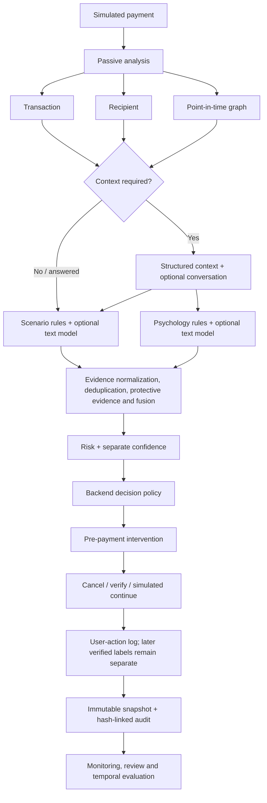

# APP Shield architecture

APP Shield is a local research prototype. The backend is authoritative for scores, confidence, scenario, decision, and intervention; the React client collects payment/context inputs and renders API outputs.

Transaction/recipient/graph features use timestamp-bounded history. Conversation text is optional and bounded. Missing evidence remains explicitly missing. The current learned fusion artifact is trained/evaluated on transaction/recipient synthetic features; the full live simulator also has interpretable context/scenario/psychology and graph evidence, but those modalities do not have linked temporal labels in that training corpus. The research API stores aggregate-monitoring inputs locally in SQLite. Automatic retraining and promotion are disabled.

## Runtime boundaries

- FastAPI (`backend/app/main.py`) owns inference and orchestration.
- `PaymentSimulator` is in-memory and never calls a payment provider.
- Feedback/audit/review persistence uses a local SQLite repository.
- NetworkX graph features are built as of each payment timestamp.
- The React/Vite frontend is a client only; it contains no independent risk policy.
- Docker Compose binds both services to loopback and persists only demo feedback in a named volume.

## Future production shape

A real platform would place an inference service beside its payment orchestrator, use an online point-in-time feature store, integrate an analyst case system and governed model registry, and monitor latency/quality under privacy and security controls. These are design directions, not implemented integrations.
